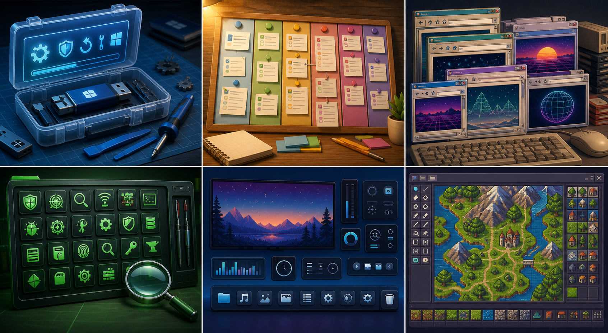

  

# Hey, I'm Rice2K

I build useful little command centers for Windows, repair workflows, retro web preservation, GraalOnline tooling, and searchable project archives. A lot of my work lives where practical tech meets old-internet curiosity: desktop utilities, recovered resources, toolkit dashboards, and experiments that make messy folders of knowledge easier to use.

I like projects that are direct, offline-friendly, and hands-on. If it helps someone repair a machine, organize a workflow, dig through old web history, customize their desktop, or understand a pile of tools faster, that is usually my kind of build.

  

## Featured Projects

| Project | What it is |
| --- | --- |
| [Rice2k Computer Cleaner](https://github.com/rice2k/rice2k-computer-cleaner) | Windows desktop PC care app for safe scans, cache cleanup, startup review, update review, driver age checks, and duplicate finding. |
| [Rice2k Magic Tasks](https://github.com/rice2k/rice2k-magic-tasks) | Colorful Windows task planner with draggable tasks, reminders, calendar events, focus mode, templates, hotkeys, and themes. |
| [Old Free Online Resources](https://github.com/rice2k/old-free-online-resources) | Searchable archive of old free online resources, recovered links, screenshots, and web-directory style collections. |
| [Cyber Tool Atlas](https://github.com/rice2k/cyber-tool-atlas) | Clean searchable cybersecurity tools directory for browsing utilities and references without the noise. |
| [R2K RescueDesk USB](https://github.com/rice2k/r2k-rescuedesk-usb) | Service-bench USB command center for intake, triage, backup, Windows repair, WinPE workflows, reports, and closeout. |
| [Rainmeter Control Bar](https://github.com/rice2k/rice2k-rainmeter-control-bar) | Rainmeter skin and GitHub Pages showcase for a desktop control bar with system-monitor and widget energy. |
| [BTK Graal Guild Site Archive](https://github.com/rice2k/BTK-Graal-Guild-site-Remake-Archive) | Restored offline Graal guild site pages, forum archive, screenshots, and Wayback source links. |
| [Graalians Discord Server Tool Hub](https://github.com/rice2k/Graalians-Discord-Server-Tool-Hub) | Tool hub around GraalOnline and Graalians workflows, including level, map, script, and community utilities. |

## What I Build Around

- Windows maintenance, diagnostics, repair USBs, and service-desk flows
- Productivity tools that feel colorful, fast, and low-friction
- Retro web preservation, old resource directories, and recovered web culture
- GraalOnline tools, level/map utilities, archives, and community helper projects
- Searchable dashboards for catalogs that would otherwise become messy bookmarks
- Desktop customization, Rainmeter, widgets, and practical UI experiments

## Current Vibe

I'm turning scattered utilities and archives into cleaner, easier-to-use project homes. The goal is simple: make each project feel like it has a front door, a clear purpose, and enough personality that someone can tell what it does in a few seconds.

---

  <a href="https://github.com/rice2k?tab=repositories">Projects</a>
  ·
  <a href="https://rice2k.github.io/old-free-online-resources/">Old Free Online Resources</a>
  ·
  <a href="https://rice2k.github.io/r2k-rescuedesk-usb/">R2K RescueDesk USB</a>
  ·
  <a href="https://rice2k.github.io/rice2k-rainmeter-control-bar/">Rainmeter Control Bar</a>

