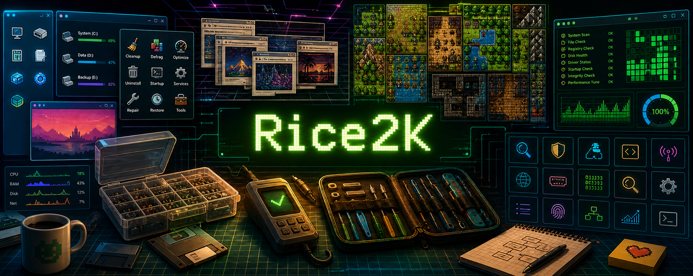
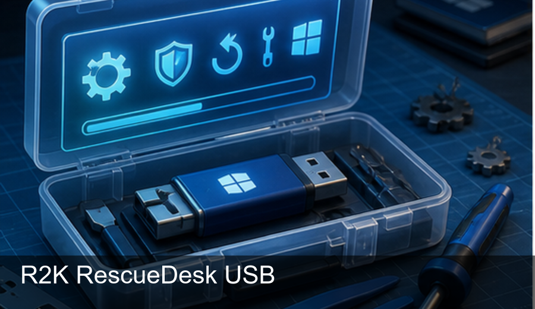
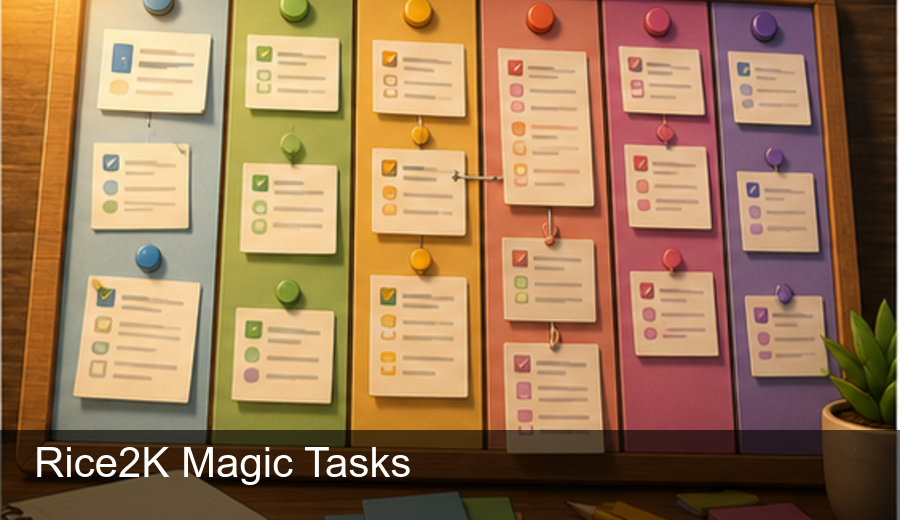
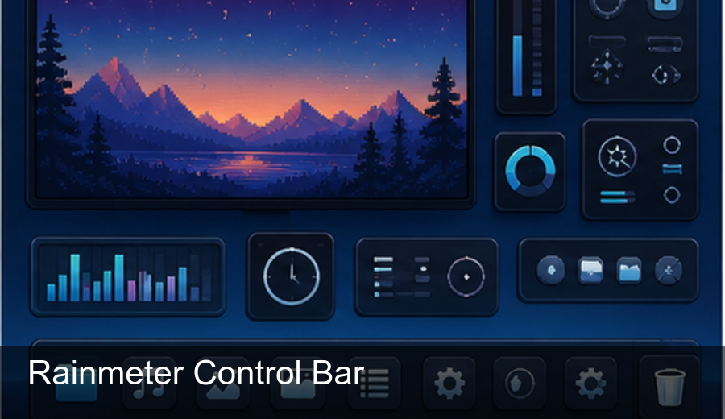
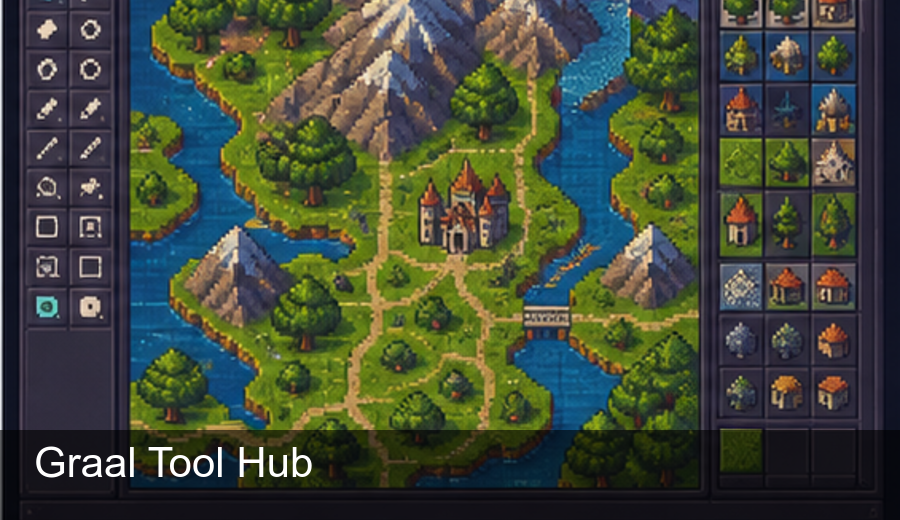

  

<h1 align="center">Christopher Schumacher • Rice2K</h1>

  IT • Windows utilities • GraalOnline preservation • retro web archives • desktop tools

  
  
  
  
  
  

I build useful little command centers for Windows, repair workflows, retro web preservation, GraalOnline tooling, and searchable project archives. A lot of my work lives where practical tech meets old-internet curiosity: desktop utilities, recovered resources, toolkit dashboards, and experiments that make messy folders of knowledge easier to use.

I like projects that are direct, offline-friendly, and hands-on. If it helps someone repair a machine, organize a workflow, dig through old web history, customize their desktop, or understand a pile of tools faster, that is usually my kind of build.

## Featured Projects

<table>
  <tr>
    <td width="33%" valign="top">
      
       
      <strong><a href="https://github.com/rice2k/r2k-rescuedesk-usb">R2K RescueDesk USB</a></strong>
       
      Service-bench USB command center for intake, triage, backup, Windows repair, WinPE workflows, reports, and closeout.
    </td>
    <td width="33%" valign="top">
      
       
      <strong><a href="https://github.com/rice2k/rice2k-magic-tasks">Rice2K Magic Tasks</a></strong>
       
      Colorful Windows task planner with draggable tasks, reminders, calendar events, focus mode, templates, hotkeys, and themes.
    </td>
    <td width="33%" valign="top">
      
       
      <strong><a href="https://github.com/rice2k/old-free-online-resources">Old Free Online Resources</a></strong>
       
      Searchable archive of old free online resources, recovered links, screenshots, and web-directory style collections.
    </td>
  </tr>
  <tr>
    <td width="33%" valign="top">
      
       
      <strong><a href="https://github.com/rice2k/cyber-tool-atlas">Cyber Tool Atlas</a></strong>
       
      Clean searchable cybersecurity tools directory for browsing utilities and references without the noise.
    </td>
    <td width="33%" valign="top">
      
       
      <strong><a href="https://github.com/rice2k/rice2k-rainmeter-control-bar">Rainmeter Control Bar</a></strong>
       
      Rainmeter skin and GitHub Pages showcase for a desktop control bar with system-monitor and widget energy.
    </td>
    <td width="33%" valign="top">
      
       
      <strong><a href="https://github.com/rice2k/Graalians-Discord-Server-Tool-Hub">Graal Tool Hub</a></strong>
       
      GraalOnline and Graalians workflows, including level, map, script, and community utilities.
    </td>
  </tr>
</table>

More builds: [Rice2K Computer Cleaner](https://github.com/rice2k/rice2k-computer-cleaner), [BTK Graal Guild Site Archive](https://github.com/rice2k/BTK-Graal-Guild-site-Remake-Archive), and [all repositories](https://github.com/rice2k?tab=repositories).

## Graal & Preservation Projects

- **[Graal Level Viewer](https://github.com/rice2k/Graal-Level-Viewer)** — preserved C# Windows level-viewer project with updated build notes and upstream attribution.
- **[GS2 Scripts](https://github.com/rice2k/gs2-scripts)** — Graal Script 2 examples and a documented SQLite-backed guild-management system.
- **[Graalians Discord Server Tool Hub](https://github.com/rice2k/Graalians-Discord-Server-Tool-Hub)** — community-focused Graal tooling and workflows.
- **[BTK Graal Guild Site Archive](https://github.com/rice2k/BTK-Graal-Guild-site-Remake-Archive)** — preservation/remake work around older Graal community web content.
- **[Old Free Online Resources](https://github.com/rice2k/old-free-online-resources)** — searchable old-web resource archive and recovered-link collection.

## What I Build Around

- Windows maintenance, diagnostics, repair USBs, and service-desk flows
- Productivity tools that feel colorful, fast, and low-friction
- Retro web preservation, old resource directories, and recovered web culture
- GraalOnline tools, level/map utilities, archives, and community helper projects
- Searchable dashboards for catalogs that would otherwise become messy bookmarks
- Desktop customization, Rainmeter, widgets, and practical UI experiments

## GitHub Activity

  
  

> GitHub's native Achievements are shown separately on the profile when **Show Achievements on my profile** is enabled in GitHub profile settings.

## Current Focus

I'm turning scattered utilities and archives into cleaner, easier-to-use project homes. The goal is simple: make each project feel like it has a front door, a clear purpose, and enough personality that someone can tell what it does in a few seconds.

---

  <a href="https://github.com/rice2k?tab=repositories">All Projects</a>
  ·
  <a href="https://github.com/rice2k?tab=followers">Followers</a>
  ·
  <a href="https://rice2k.github.io/old-free-online-resources/">Old Web Archive</a>
  ·
  <a href="https://rice2k.github.io/r2k-rescuedesk-usb/">RescueDesk USB</a>
  ·
  <a href="https://rice2k.github.io/rice2k-rainmeter-control-bar/">Rainmeter Control Bar</a>

